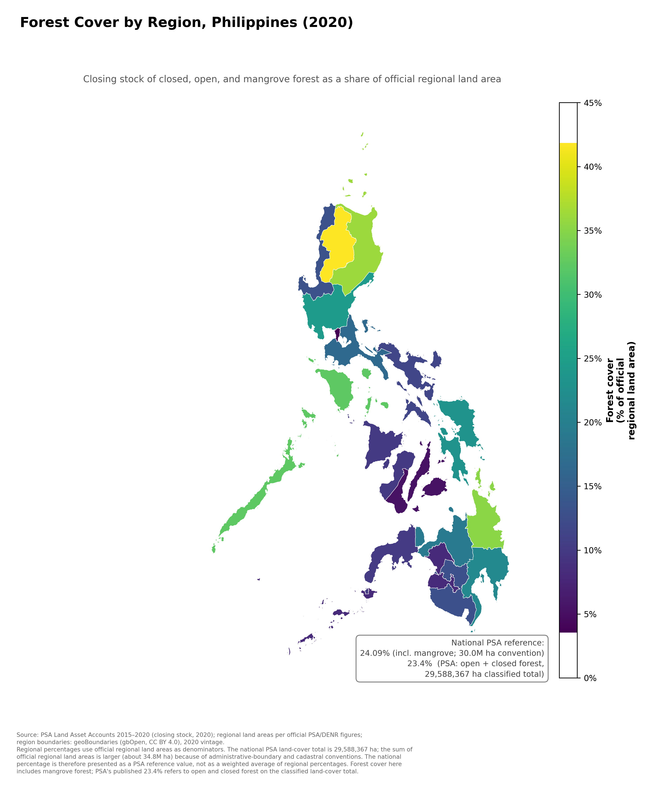

# Forest Cover by Region, Philippines (2020)

A publication-ready R choropleth of **forest-cover percentage by region**, built from the PSA Land Asset Accounts 2015–2020 (2020 closing stock) and official regional land areas.



---

## Data Profile & Scope

- **Forest measure:** closed + open + mangrove forest, 2020 closing stock (hectares), verified cell-by-cell against the PSA statistical tables.
- **Denominator:** official PSA/DENR regional land areas — **not** the national accounting total. The two systems do not reconcile by design (see [NOTES.md](NOTES.md)).
- **National reference:** 24.09% (incl. mangrove; 30.0M ha convention) and PSA's published 23.4% (open + closed forest on 29,588,367 ha classified total) — shown as annotations, never as a weighted mean of regions.
- **Coverage:** all 17 regions, including BARMM.

## Repository Architecture

```text
ph_forest_cover.R            # Full pipeline: validate -> join -> map -> export
ph_forest_cover_2020.csv     # Verified data: region, forest classes, land area, forest %
ph_regions.gpkg              # Region boundaries (add from PSA/NAMRIA/PhilGIS/GADM)
NOTES.md                     # Verification report + denominator definitions + methods wording
README.md
```

## How to Run

### 1. Prerequisites

```r
install.packages(c("tidyverse", "sf", "scales"))
```

### 2. Steps

1. Place a region-level boundary file in the folder as `ph_regions.gpkg` (official PSA/NAMRIA, PhilGIS, or GADM level-1 all work).
2. Open `ph_forest_cover.R`.
3. Check the join column name in BATCH 2 (`by = c("name" = "region")`) and the crosswalk table — adjust to your boundary file's naming.
4. Run the script top to bottom. The map is saved to `output/ph_forest_cover_2020.png` (and SVG).

The script validates the data before mapping: 17 regions required, no missing values, forest area never exceeds land area, and a warning if any polygon fails to join.

## License

Released under the MIT License. The underlying statistics are from the
Philippine Statistics Authority (public sector information).

## Honest denominators

Regional percentages use official regional land areas. The national PSA land-cover total (29,588,367 ha) and the sum of official regional land areas (~34.8M ha) differ because of administrative-boundary and cadastral conventions. The national percentage is therefore presented as a PSA reference value, not a weighted average of regional percentages. Full treatment in [NOTES.md](NOTES.md).
